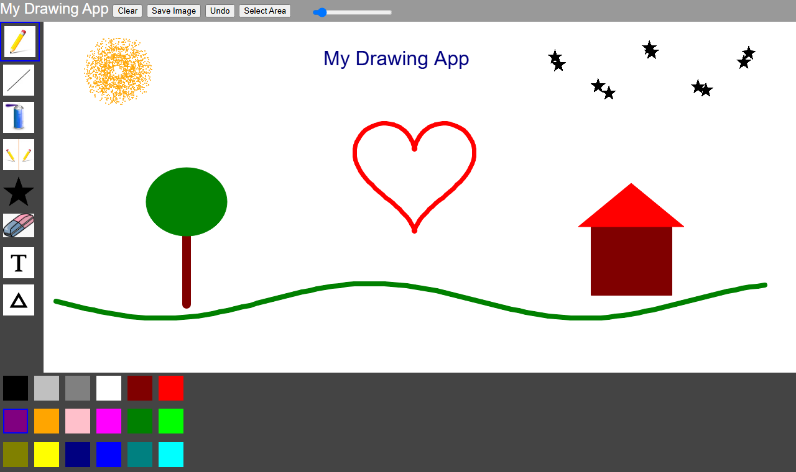

# Drawing App

A browser drawing app built with **p5.js**, with 8 tools, an 18-colour palette, undo, select-and-move (cut & paste) and save-to-image.

**▶ [Try it online](https://ziadelh.github.io/drawing-app/)**

> Built on the course's starter framework (freehand, line, spray can and mirror tools, colour palette, clear and save). I designed and implemented the undo system, select/cut/paste, the star stamp, eraser and text tools, the shapes menu, and adjustable size sliders for the tools.

## Tools

| Tool | What it does |
|---|---|
| **Freehand** | Draw freely with an adjustable brush size |
| **Line** | Straight lines with adjustable width |
| **Spray can** | Spray-paint effect with adjustable dot size |
| **Mirror** | Draws symmetrically; toggle between a vertical and horizontal axis |
| **Star stamp** | Stamps stars; sliders for star size and stars per stamp |
| **Eraser** | Erase with an adjustable size |
| **Text** | Click anywhere and type; adjustable text size |
| **Shapes** | Dropdown for rectangle, ellipse or triangle, each filled or outlined; the toolbar icon updates to the chosen shape |

Plus:
- **Undo:** steps back through every action, including cuts and pastes
- **Select Area → Cut → click to paste:** move part of a drawing anywhere on the canvas
- **Clear** and **Save Image** (downloads a JPG)

## How It's Built

- **Modular tools:** each tool is its own object with a shared interface (`draw`, `populateOptions`, `unselectTool`) and is registered in a `Toolbox` that builds the sidebar
- **Undo stack:** every action is saved as a transparent layer; undo removes the last layer and redraws the canvas from the remaining ones

## Tech Stack

JavaScript · p5.js · p5.dom · HTML · CSS Grid

## Run

Try it [online](https://ziadelh.github.io/drawing-app/), or run it locally by opening `index.html` with the VS Code **Live Server** extension.

## Author

Ziad Elhussein
